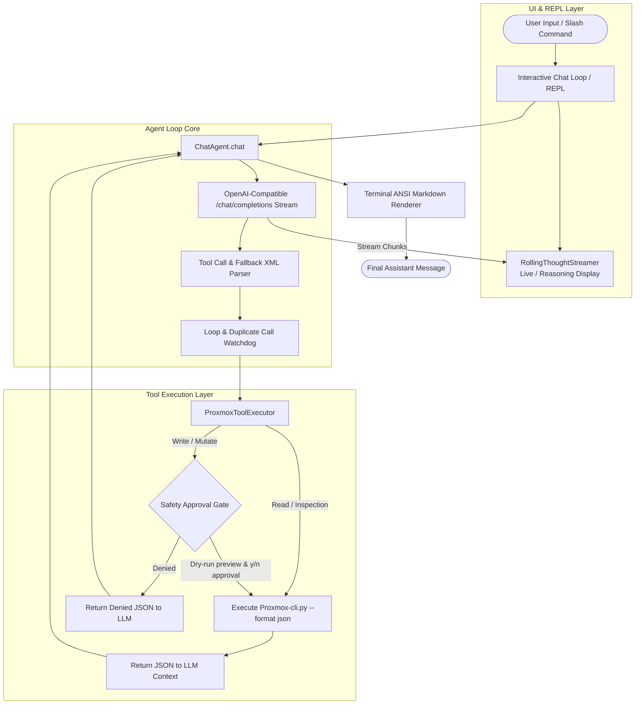

# chat.py — Implementation Plan & Architecture Specification

An autonomous, interactive AI assistant chat interface for managing Proxmox VE environments via the safety-guarded `Proxmox-cli.py` CLI wrapper.

---

## 1. Overview & Objectives

`chat.py` is an interactive command-line agent interface that translates natural language prompts into Proxmox management tasks. Instead of implementing direct, unvalidated Proxmox API calls, `chat.py` invokes `/home/svaye/Scripts/ProxBot/scripts/Proxmox-cli.py` as a subprocess with structured `--format json` output.

### Key Goals:
- **OpenAI-Compatible LLM Integration**: Connect to any OpenAI-compatible API endpoint (LM Studio, Ollama, vLLM, OpenAI, DeepSeek, etc.).
- **Subprocess Tool Execution**: Route all infrastructure interactions through `scripts/Proxmox-cli.py --env-file /home/svaye/Scripts/ProxBot/.env --format json`.
- **Reasoning Streamer**: Visually render model `<think>` and reasoning tokens cleanly using a rolling thought ticker.
- **Safety Guardrails & Approval Gates**: Auto-execute read-only queries, require interactive approval (`[y/n/a]`) for write operations, and enforce confirmation parameters for destructive actions.
- **Loop & Duplicate Suppression**: Detect and prevent recursive or infinite tool-calling loops from LLMs.
- **Rich Terminal UI**: Render tables, code blocks, status badges, and markdown using an ANSI terminal renderer.

---

## 2. Directory Layout

```text
/home/svaye/Scripts/ProxBot/
├─ chat.py                       # Main interactive chat agent & REPL
├─ chat-script-plan.md           # This specification document
├─ requirements.txt              # Project dependencies
├─ .env                          # Proxmox & LLM endpoint configuration
├─ .env.example                  # Documented environment template
├─ docs/                         # Specifications & API notes
└─ scripts/
   ├─ Proxmox-cli.py             # Target CLI execution script
   ├─ Proxmox-console.py         # Console broker script
   ├─ BUGS.md                    # Bug tracking
   ├─ IMPROVEMENTS.md            # Improvement suggestions
   └─ logs/
      ├─ .gitkeep
      └─ chat-sessions/          # Structured JSONL session logs
```

---

## 3. System Architecture & Flow



---

## 4. Component Design & Class Structure

### 4.1. `render_markdown(text: str) -> str`
A terminal renderer providing formatted output without heavy external dependencies:
- **Tables**: Parses markdown tables and outputs Unicode box borders (`┌─┬─┐`, `│`, `├─┼─┤`, `└─┴─┘`) with auto-padded column widths.
- **Code Blocks**: Formatted with border lines (`┌── <lang>`, `│`, `└──`).
- **Headers**: Formats `#`, `##`, `###` with bold colors and symbols.
- **Inline Styling**: Bold (`**`), italic (`*`), and inline code (`` `code` `` in yellow).

### 4.2. `SessionLogger`
Structured JSONL logging for agent auditing and troubleshooting:
- Stored under `scripts/logs/chat-sessions/chat-<session_id>.jsonl`.
- Events logged: `USER`, `AGENT`, `TOOL_CALL`, `TOOL_RESULT`, `TOOL_DENIED`, `SYSTEM`, `ERROR`.
- Sensitive arguments (`--password`, `--token-secret`, `--key`, etc.) are automatically redacted.

### 4.3. `RollingThoughtStreamer`
Terminal visualizer for streaming reasoning and `<think>` tokens:
- Runs a background thread ticker that scrolls thought tokens in real-time.
- Captures both `delta.reasoning_content` (OpenAI / DeepSeek format) and inline `<think>...</think>` XML tags.
- Cleans up and clears line space once thinking completes, transitioning smoothly to tool execution or final content.

### 4.4. `ProxmoxToolExecutor`
Executes tools by invoking `scripts/Proxmox-cli.py` as a subprocess:
- **Command Construction**:
  ```python
  cmd = [
      sys.executable,
      "/home/svaye/Scripts/ProxBot/scripts/Proxmox-cli.py",
      "--env-file", "/home/svaye/Scripts/ProxBot/.env",
      "--format", "json"
  ] + parsed_tool_args
  ```
- **Execution & Output Parsing**:
  - Captures stdout/stderr.
  - Parses JSON output and handles exit codes (`EXIT_SUCCESS`, `EXIT_VALIDATION`, `EXIT_SAFETY`, etc.).
  - Returns structured results back to the agent loop.

### 4.5. `extract_embedded_tool_calls(text: str) -> Tuple[str, List[Dict[str, Any]]]`
Fallback parser for smaller or local models:
- Detects tool calls emitted directly into message content (e.g. `<tool_call>{"name": "...", "arguments": {...}}</tool_call>` or ` ```json {"tool": ...} ``` `).
- Extracts and executes them as valid tool calls while cleaning the user-visible text.

### 4.6. `ChatAgent`
The central orchestrator managing conversation state:
- **`__init__()`**: Configures LLM base URL, API key, model selection, tool specifications, and session limits.
- **`chat(user_input: str) -> str`**: Multi-turn agent loop:
  1. Appends user prompt to history.
  2. Sends streaming request to `/chat/completions` with `TOOLS_SPEC`.
  3. Dispatches reasoning tokens to `RollingThoughtStreamer`.
  4. Collects and parses tool calls.
  5. Evaluates call signatures in `seen_calls` to suppress duplicate loops.
  6. Evaluates safety policies and prompts user for approval on write actions.
  7. Executes tool calls via `ProxmoxToolExecutor` and appends results.
  8. Repeats until the model outputs a final conversational response (up to `max_turns`).
- **`_prune_history()`**: Truncates large tool responses from earlier turns to prevent context window overflow.

---

## 5. Tool Specifications (`TOOLS_SPEC`)

The agent will be equipped with tool definitions corresponding to canonical `Proxmox-cli.py` operations:

| Tool Name | CLI Command Mapping | Risk Level | Safety Behavior |
| :--- | :--- | :--- | :--- |
| `nodes_list` | `nodes list` | Read-only | Auto-executes |
| `node_status` | `node status --node <node>` | Read-only | Auto-executes |
| `resolve_vmid` | `resolve --vmid <id> [--kind vm\|lxc]` | Read-only | Auto-executes |
| `vms_list` | `vms list --node <node>` | Read-only | Auto-executes |
| `lxcs_list` | `lxcs list --node <node>` | Read-only | Auto-executes |
| `vm_status` | `vm status --node <node> --vmid <id>` | Read-only | Auto-executes |
| `vm_config` | `vm config --node <node> --vmid <id>` | Read-only | Auto-executes |
| `vm_guest_network` | `vm guest-network --node <node> --vmid <id>` | Read-only | Auto-executes |
| `lxc_status` | `lxc status --node <node> --vmid <id>` | Read-only | Auto-executes |
| `storage_list` | `storage list --node <node>` | Read-only | Auto-executes |
| `storage_content` | `storage content --node <node> --storage <stg>` | Read-only | Auto-executes |
| `tasks_recent` | `tasks recent --node <node>` | Read-only | Auto-executes |
| `vm_start` | `vm start --node <node> --vmid <id> --execute --wait` | Write | Approval prompt `[y/n/a]` |
| `vm_shutdown` | `vm shutdown --node <node> --vmid <id> --execute --wait` | Write | Approval prompt `[y/n/a]` |
| `vm_reboot` | `vm reboot --node <node> --vmid <id> --execute --wait` | Write | Approval prompt `[y/n/a]` |
| `vm_stop` | `vm stop --node <node> --vmid <id> --execute --force --confirm <id>` | Destructive | Explicit confirmation prompt |
| `vm_snapshot_create`| `vm snapshot create --node <node> --vmid <id> --name <name> --execute` | Write | Approval prompt `[y/n/a]` |
| `lxc_start` | `lxc start --node <node> --vmid <id> --execute --wait` | Write | Approval prompt `[y/n/a]` |
| `lxc_shutdown` | `lxc shutdown --node <node> --vmid <id> --execute --wait` | Write | Approval prompt `[y/n/a]` |
| `lxc_reboot` | `lxc reboot --node <node> --vmid <id> --execute --wait` | Write | Approval prompt `[y/n/a]` |
| `lxc_stop` | `lxc stop --node <node> --vmid <id> --execute --force --confirm <id>` | Destructive | Explicit confirmation prompt |

---

## 6. Safety & Human-in-the-Loop Approval Workflow

```text
  [14:32:05] 🛡️  Action Approval Required: vm_start
      • Target Node : pve1
      • Target VMID : 101
      • Action Plan : Start VM 101 on node pve1 with --wait
    Approve modification? [y(yes)/n(no)/a(auto-all)]: 
```

1. **Read-Only**: Any inspection command executes immediately and feeds data back into the LLM context.
2. **State-Changing (Write)**:
   - Pauses execution and prints targeted details.
   - User inputs `y` (proceed once), `n` (reject and inform model), or `a` (enable auto-approval for current session).
   - If approved, executes with `--execute`.
   - If denied, appends a tool rejection result instructing the LLM that the user aborted the action.
3. **Destructive**:
   - Always prompts with high-visibility warning banner.
   - If approved, passes `--execute --force --confirm <vmid>`.

---

## 7. Interactive REPL & Slash Commands

The interactive `main()` loop supports standard chat alongside built-in operational commands:

- `/doctor`: Executes `Proxmox-cli.py doctor` and displays cluster connectivity diagnostics.
- `/nodes`: Quick summary of online/offline cluster nodes.
- `/vms [node]`: Quick list of VMs across nodes.
- `/model`: View or switch active LLM models on the endpoint.
- `/auto`: Toggle auto-approval mode for write operations.
- `/new`: Start a new chat session (reset context + fresh log) but leave old messages on screen.
- `/clear`: Clear the screen and reset conversation context (fresh log).
- `/help`: Display supported slash commands and examples.
- `/exit` or `/quit`: Print session statistics (duration, tool calls made, approvals) and exit cleanly.

---

## 8. Configuration (`.env`)

Add the following LLM configuration keys to `/home/svaye/Scripts/ProxBot/.env`:

```dotenv
# LLM Endpoint Configuration
LLM_BASE_URL=http://localhost:1234/v1     # LM Studio, Ollama (http://localhost:11434/v1), vLLM, etc.
LLM_API_KEY=not-needed                     # API Key if required by provider
LLM_MODEL=qwen2.5-coder-7b-instruct        # Model identifier
LLM_TEMPERATURE=0.2
LLM_MAX_TURNS=15

# Chat Session Logging
CHAT_LOG_DIR=scripts/logs/chat-sessions
CHAT_AUTO_APPROVE=false
```

---

## 9. Implementation Roadmap

1. **Phase 1: Environment & Scaffolding**:
   - Update `requirements.txt` if needed (ensure `requests`, `python-dotenv` are present).
   - Create `scripts/logs/chat-sessions/` directory.
   - Configure `.env` with LLM endpoint settings.

2. **Phase 2: Core Subprocess & Tool Executor**:
   - Build `ProxmoxToolExecutor` to interface cleanly with `Proxmox-cli.py`.
   - Implement exit code handling and output formatting.

3. **Phase 3: Agent Loop & Streaming UI**:
   - Implement `RollingThoughtStreamer` and `render_markdown`.
   - Implement `ChatAgent` with streaming chat completion and tool call dispatching.
   - Implement fallback tool call parser and duplicate watchdog.

4. **Phase 4: Safety Gate & REPL**:
   - Add interactive approval prompts for write/destructive actions.
   - Build `main()` REPL loop with readline history and slash commands.

5. **Phase 5: Verification & Testing**:
   - Test against live or mock Proxmox environment.
   - Validate dry-run and approval workflows.
   - Confirm log output and credential redaction.
