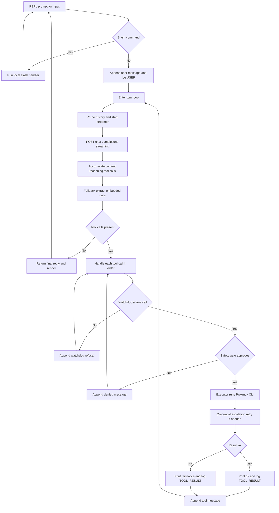

# Main Agent Chat Loop Layout

Reference layout of the ProxBot interactive agent loop. Source of truth is
`src/proxbot/chat/agent.py:ChatAgent.chat` (inner LLM turn loop) composed by
`chat.py:main` (outer REPL loop).

File map:

- Outer REPL: `chat.py:132-349` (`main`)
- Inner loop: `src/proxbot/chat/agent.py:210-611` (`ChatAgent.chat`)
- Tool spec: `src/proxbot/chat/spec.py` (`TOOLS_SPEC`, `READ_ONLY_TOOLS`, `WRITE_TOOLS`, `DESTRUCTIVE_TOOLS`, `HARNESS_ASSEMBLED_TOOLS`)
- Execution: `src/proxbot/chat/executor.py:ProxmoxToolExecutor` (tool name → `scripts/Proxmox-cli.py` subprocess argv)
- Approval gate: `src/proxbot/chat/safety.py:SafetyGate.check_and_prompt`
- Loop guard: `src/proxbot/chat/watchdog.py:LoopWatchdog.check_call` + `validate_harness_command`
- Streaming UI: `src/proxbot/chat/streamer.py:RollingThoughtStreamer`
- Logging: `src/proxbot/chat/session.py:SessionLogger` (JSONL to `scripts/logs/chat-sessions/chat-<id>.jsonl`)
- Terminal/markdown: `src/proxbot/chat/markdown.py`, `src/proxbot/chat/terminal.py`

## 1. Outer REPL loop (`chat.py:main`)

```
startup
  load .env, resolve base_url / api_key / model / temperature / max_turns
  SessionLogger(log_dir) → executor → safety_gate → ChatAgent(...)
  if argv prompt: agent.chat(prompt) once, print, exit
  else: setup_readline, print_banner
    loop forever:
      user_line = prompt_input("proxbot › ")
      if starts with "/": handle slash command (no LLM call), continue
      else: response = agent.chat(user_line); render_markdown(response)
    finally: save_readline, print session stats
```

Slash commands (all handled locally, `chat.py:160-333`):

| Command | Action |
|---|---|
| `/exit`, `/quit`, `/q` | break loop |
| `/help` | `print_help()` |
| `/clear` | `agent.clear_history()` + `logger.new_session()` + clear screen + banner |
| `/new` | `agent.clear_history()` + `logger.new_session()` (screen kept) |
| `/auto` | toggle `safety_gate.auto_approve` |
| `/model [name]` | pin model or list backend models via `fetch_backend_models` |
| `/doctor` | `executor.execute("doctor", {"live": True})` |
| `/nodes`, `/vms [node]`, `/lxcs [node]`, `/storage [node]`, `/templates [node]`, `/registry [search]` | `executor.execute(...)` + markdown table render |

## 2. Inner agent loop (`ChatAgent.chat`, `agent.py:210-611`)

One `chat(user_input)` call = up to `max_turns` (from `LLM_MAX_TURNS`, default 15) LLM→tools→LLM turns:

```
append {role:user} to messages, log USER, watchdog.reset_turn()
turn = 0, final_reply = ""
while turn < max_turns:
  turn += 1
  _prune_history()                       # >16 msgs: truncate old tool outputs >1000 chars
  streamer = RollingThoughtStreamer(); streamer.start()

  POST {base_url}/chat/completions        # agent.py:252
    {model, messages, tools: TOOLS_SPEC, temperature, stream: True}
    headers: Bearer api_key
    timeout=120, non-200 → log ERROR, return error string

  stream SSE lines ("data: ...", "[DONE]" ends):
    delta.reasoning_content|reasoning → accumulated_reasoning + streamer.push()
    delta.content → accumulated_content, with inline <think>...</think> split
                   (think chunks go to reasoning + streamer)
    delta.tool_calls[] → accumulated_tool_calls[index] += {id, name, arguments}
  streamer.finish()

  if no streamed tool_calls and content exists:
    cleaned, extracted = extract_embedded_tool_calls(content)  # watchdog.py:8
    # accepts <tool_call>{"name","arguments"}</tool_call> or ```json block
    # stripped text becomes content, extracted list becomes tool calls

  append {role:assistant, content, tool_calls?} to messages; log AGENT

  if no tool_calls:
    final_reply = accumulated_content; break

  for each tool_call in turn:             # sequential, in order
    parse arguments JSON ({} on failure)
    print "→ {name} (k=v, ...)", log TOOL_CALL, stats.tool_calls += 1
    2a. watchdog.check_call(name, args)  # refuse → append tool error, continue
    2b. safety_gate.check_and_prompt()   # deny → append denied tool msg, continue
    2c. executor.execute(name, args)     # timed; "running… (up to Ns)" heartbeat for *_exec
    2d. credential escalation retries (see §4)
    2e. print ✓ (ok) / ! (benign SSH notice) / ✗ (real failure) + duration
    2f. sanitize result (redact password, command, error) → log TOOL_RESULT
    2g. append {role:tool, tool_call_id, name, content: json(result)}
# loop back for next turn; LLM sees all new tool results
return final_reply
KeyboardInterrupt at any point → finish streamer, log USER_INTERRUPT, return ""
```

### Message history shape

```
[{role:system, content: SYSTEM_PROMPT},
 {role:user, content},
 {role:assistant, content, tool_calls:[{id, type:function, function:{name, arguments}}]},
 {role:tool, tool_call_id, name, content: "<json result>"},
 ... repeats ...]
```

`clear_history()` (`agent.py:94`) resets to `[system]` + fresh watchdog + clears cached node passwords.

## 3. Per-tool-call pipeline detail

Order is fixed; a step that refuses stops the call before the next step runs:

1. **Watchdog** (`watchdog.py:134`): `validate_harness_command` first for `lxc_pct_exec` (unknown args, non-numeric vmid, empty command, leading `pct` all refused pre-prompt), then max 12 calls/turn, max 2 identical (name + sorted-args) calls, alternating A-B-A-B cycle detection. Refusal text is fed back to the model as a tool error.
2. **Safety gate** (`safety.py:14`): read-only tools auto-pass. `WRITE_TOOLS` prompt `[y/n/a]` (`a` enables session auto-approve); `DESTRUCTIVE_TOOLS` prompt `[yes/no]`, irreversible warning. Denial → `{"ok":false,"status":"denied"}` tool message.
3. **Executor** (`executor.py:400`): re-validates `HARNESS_ASSEMBLED_TOOLS`, fans out multi-node `vms_list`/`lxcs_list`/`storage_list`, auto-stops running guest before `*_delete`, aggregates `templates_list` (vm_templates → `vm_clone`, lxc template:1 → `lxc_clone`, os tarballs → `lxc_create`), else `_build_cli_args` → `_raw_execute` subprocess (`Proxmox-cli.py --env-file … --format json …`, 180 s timeout, last-JSON-doc wins).
4. **Result render**: `✓` green ok; `!` yellow iff `_is_benign_notice` (every non-blank error/stderr/raw_output line matches known SSH chatter); else `✗` red with first error line (`_extract_error_detail`).
5. **Sanitize + log**: passwords → `***REDACTED***`, `redact_command_secrets` on `command`/`error` strings, then `SessionLogger.log("TOOL_RESULT", …)`.

## 4. Credential escalation branches (`agent.py:439-561`)

Only these three, each at most one extra attempt per call:

- `lxc_exec` + `login_required` (status field or buried CLI envelope string): `getpass` for `<user>@<node>:<vmid>` (Enter cancels), retry with `password` in args. Nothing is stored.
- `lxc_pct_exec` + `node_password_required`: reuse `self._node_prompts[node]` if cached, else `getpass` for node user. Retry via `executor.execute(name, args, secret=pwd)` — secret travels on an inherited pipe fd (`--node-password-fd`), never argv/logs/history. Cached in memory only, dropped by `clear_history()`.
- `ssh_exec` + `_is_ssh_auth_failure` (regex on error/stderr/stdout, or `ssh_auth_failed` status): stop-the-loop prompt for corrected user / key file / password (not a silent retry). Retry once with new creds; on cancel, return `ssh_auth_failed` tool error telling the model not to loop.

## 5. Streaming + logging

- `RollingThoughtStreamer` (`streamer.py`): daemon thread, 80 ms spinner + last 60 chars of reasoning tail; `finish()` clears the line, prints `thought Ns` if any reasoning arrived.
- `SessionLogger` (`session.py:54`): every event (`USER`, `AGENT`, `TOOL_CALL`, `TOOL_RESULT`, `TOOL_DENIED`, `ERROR`, `SYSTEM`, `USER_INTERRUPT`) appended as one redacted JSON line; `SENSITIVE_KEYS` + `PVEAPIToken=` + `redact_command_secrets` scrubbing. Stats counters (`user_prompts`, `tool_calls`, `tool_approvals`, `tool_denials`, `errors`) printed on REPL exit.

## 6. Loop diagram (Excalidraw-compatible Mermaid)

Paste the block below into Excalidraw via Insert Mermaid diagram.


